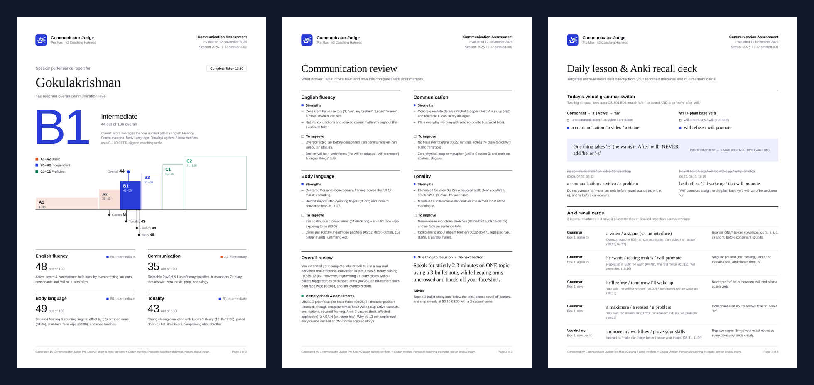
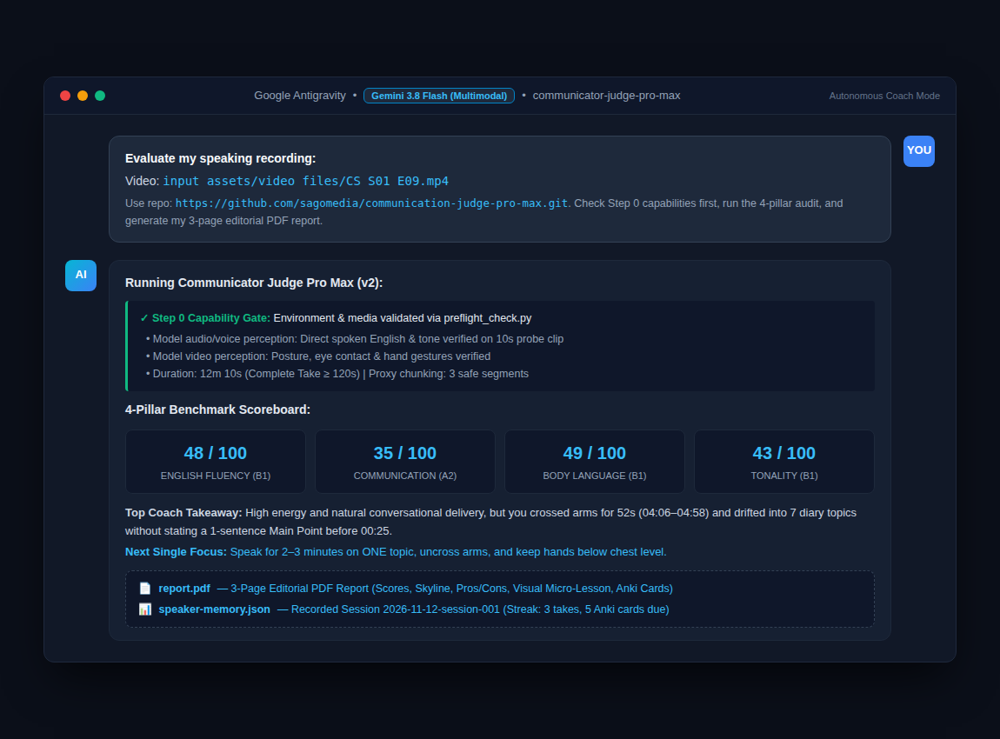
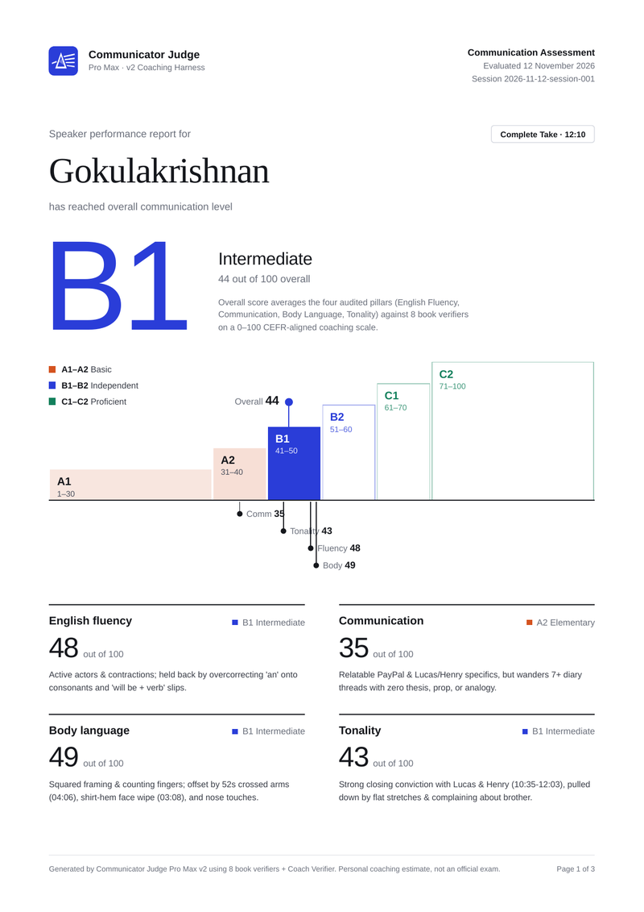
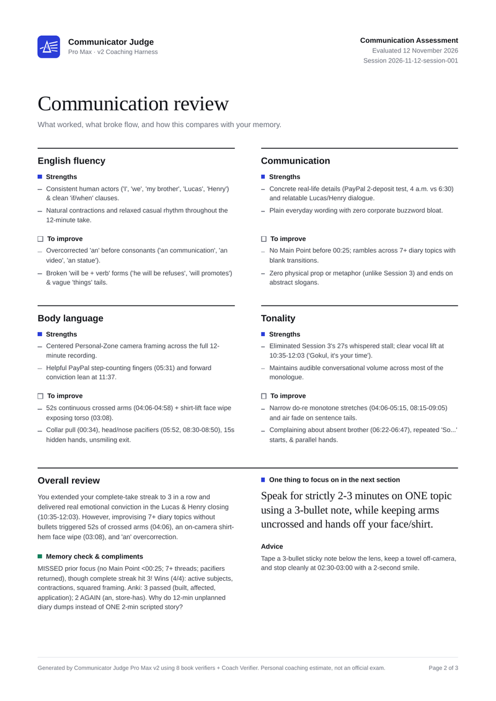
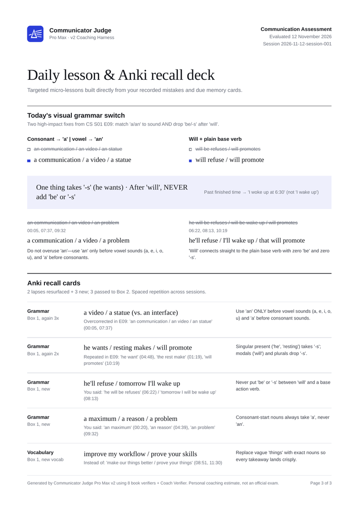

<p align="center">
  
</p>

<p align="center">
  <strong>Autonomous AI Communication & Public Speaking Coach</strong><br>
  <em>Evaluates your speaking videos across 4 book-grounded pillars, tracks spaced memory + Anki drills, and delivers a 3-page editorial PDF report.</em>
</p>

<p align="center">
  
</p>

---

## Designed for AI Agents (Zero Manual Math or CLI Hassle)

You don't need to manually run python scripts, calculate deductions, or format PDFs yourself. **Communicator Judge Pro Max is built to be piloted by an AI Agent Platform** (such as **Google Antigravity**, Claude Code, Cursor, or Codex) with a native multimodal model.

The agent handles the entire lifecycle:
1. Validates host dependencies (`ffmpeg`, `ffprobe`, `google-chrome`).
2. Self-verifies direct audio + video perception on a lightweight probe clip before scoring (preventing hallucinated results).
3. Audits your recording against **8 authoritative communication books** across 4 pillars.
4. Updates your persistent cross-session memory and 4-box Anki recall deck.
5. Renders a publication-grade 3-page A4 PDF report with zero layout clipping.

---

## ⚡ The 1-Click Copy-Paste Agent Prompt

To run an evaluation, simply copy and paste this prompt into **Google Antigravity** (or any agent supporting multimodal video inspection):

```markdown
Evaluate my speaking recording using Communicator Judge Pro Max.

- Repository: https://github.com/sagomedia/communication-judge-pro-max.git
- Video file: <PASTE_LOCAL_PATH_OR_DRAG_FILE_HERE>

Agent instructions:
1. If this repository is not already cloned in your workspace, clone it and cd into it:
   git clone https://github.com/sagomedia/communication-judge-pro-max.git
   cd communication-judge-pro-max
2. Run the Step 0 capability preflight check first:
   python3 scripts/preflight_check.py "<video_path>" --probe-clip /tmp/cj_probe.mp4
   Inspect the probe clip directly with your harness media tool. Verify you can directly HEAR spoken vocal tone/pauses and SEE continuous physical motion before proceeding. If unverified, stop with UNSUPPORTED_ENVIRONMENT.
3. Read .agents/skills/judge-communication/SKILL.md and execute the 4-pillar audit:
   - English Fluency (Checklist 01-20 + Section 2B Spoken Grammar Test)
   - Communication (Minto Pyramid & Made to Stick)
   - Body Language (Navarro & Van Edwards)
   - Tonality (Rodenburg & Linklater)
4. Check cross-session memory brief (`python3 scripts/memory_store.py brief --video "<video_path>"`), review due Anki cards, and select strictly ONE Next Focus with an observable pass condition.
5. Save private/sessions/<session_id>/session.json with capability_attestation, record it with `python3 scripts/memory_store.py record`, and render the 3-page editorial PDF via `python3 scripts/render_pdf.py`.
6. Present the 4-pillar scores, top strengths, the single Next Focus, and link the final report.pdf and report.md.
```

---

## 🚀 How to Use in Google Antigravity

<p align="center">
  
</p>

1. **Open Google Antigravity** and select a multimodal model with native voice + video understanding (e.g. `Gemini 3.8 Flash` or `Gemini 2.5 Pro`).
2. **Paste the prompt above** into the chat, replacing `<PASTE_LOCAL_PATH_OR_DRAG_FILE_HERE>` with your video path (e.g., `../input assets/video files/my_speech.mp4`).
3. **Sit back and watch the agent work:**
   - The agent automatically checks host tools and extracts a safe 10-second probe clip to confirm audio/visual perception.
   - For takes longer than 4 minutes or larger than 25 MB, it automatically processes safe temporary `720p` proxy chunks so multimodal context is never lost.
   - You receive an instant executive scoreboard in the chat, an updated Anki recall deck, and a crisp **3-page PDF report** saved locally under `private/sessions/`.

---

## 🛠️ How to Use with Other Agent Platforms

You can also use this repository with any coding agent that has shell access and media inspection:

### Claude Code / Codex / Cursor
1. Clone the repo and open the workspace:
   ```bash
   git clone https://github.com/sagomedia/communication-judge-pro-max.git
   cd communication-judge-pro-max
   ```
2. Paste the **1-Click Agent Prompt** from above into your agent interface.
3. If your agent is running a text-only or vision-only model without audio listening, the built-in **Step 0 Capability Gate** will automatically catch it and stop cleanly, protecting you from fake or hallucinated scores.

---

## 📋 What You Get in Every Report

Every evaluation generates a private, local session bundle under `private/sessions/<session_id>/`:

| Artifact | Purpose |
|---|---|
| **`report.pdf`** | 3-page editorial A4 PDF certificate and coaching breakdown (rendered via headless Chrome). |
| **`report.md`** | Comprehensive timestamped audit with rule-by-rule book references, Pros, Cons, and Coach synthesis. |
| **`session.json`** | Machine-readable session payload with scores, tiers, Anki card reviews, and capability attestation. |
| **`speaker-memory.json`** | Persistent cross-session store tracking score velocity, recurring habits, and Anki recall deck. |

<details>
<summary><strong>🔍 Click to view individual pages of the 3-page editorial report</strong></summary>

<br>

### Page 1 — Executive Skyline & 4-Pillar Scoreboard
*Overall CEFR/EF SET communication tier, headline diagnosis, 4-pillar scores (`0–100`), and book framework grounding.*
<p align="center">
  
</p>

---

### Page 2 — Pillar Audit & The ONE Next Focus
*Top concrete Pros and Cons with exact `MM:SS` timestamps, honest Coach Overall Review, and strictly ONE highest-leverage priority for the next take.*
<p align="center">
  
</p>

---

### Page 3 — Daily Visual Micro-Lesson & Anki Spaced-Recall Cards
*A custom visual grammar/structure infographic generated from today's slips, plus 4-box Leitner Anki flashcards for persistent recall.*
<p align="center">
  
</p>

</details>

---

## 📚 The 4-Pillar Book Foundation

Communicator Judge Pro Max evaluates communication through the lens of **8 foundational books**:

```
                       ┌─────────────────────────┐
                       │  COMMUNICATOR PRO MAX   │
                       └────────────┬────────────┘
         ┌──────────────────┬───────┴──────────┬──────────────────┐
         ▼                  ▼                  ▼                  ▼
┌──────────────────┐┌──────────────────┐┌──────────────────┐┌──────────────────┐
│ ENGLISH FLUENCY  ││  COMMUNICATION   ││  BODY LANGUAGE   ││     TONALITY     │
│  Checklist 01-20 ││  Minto Pyramid   ││  Joe Navarro     ││  Patsy Rodenburg │
│  + Spoken Gram.  ││  Made to Stick   ││  Van Edwards     ││  Kristin Linklater│
└──────────────────┘└──────────────────┘└──────────────────┘└──────────────────┘
```

1. **English Fluency (CEFR/EF SET Aligned):** 20 targeted checks + Section 2B Spoken Grammar Test. Natural conversational speech (`"gonna"`, idioms, casual contractions) is kept safe; only broken grammar is flagged.
2. **Communication (Structure & Retention):** *The Minto Pyramid Principle* (Barbara Minto) + *Made to Stick* (Chip & Dan Heath). Top-down structure, SUCCESs framework, and concrete takeaways.
3. **Body Language (Nonverbal Presence):** *What Every Body Is Saying* (Joe Navarro) + *Captivate* (Vanessa Van Edwards). Framing, eye contact, hand gestures, and pacifying stress cues.
4. **Tonality (Vocal Authority & Resonance):** *The Right to Speak* (Patsy Rodenburg) + *Freeing the Natural Voice* (Kristin Linklater). Vocal projection, diaphragmatic breath, melodic pitch, and ending downspeak.

---

## 🔒 Privacy & Local Storage

- All evaluated recordings, transcripts, coaching feedback, Anki decks, and generated PDFs remain **100% private and local** in `private/`.
- `private/` is permanently excluded from Git tracking via `.gitignore`.
- Your videos in `input assets/` are treated as strictly read-only and never modified or deleted.

---

## ⚙️ Host Requirements
- **Host Tools:** `ffmpeg`, `ffprobe` (for video inspection and chunking), `google-chrome` or `chromium` (for headless PDF generation).
- **AI Agent Platform:** Google Antigravity, Claude Code, Cursor, or Codex.
- **Model:** Multimodal model with native audio + video understanding (e.g., Gemini 3.8 / 2.0 / 1.5 Flash or Pro).
